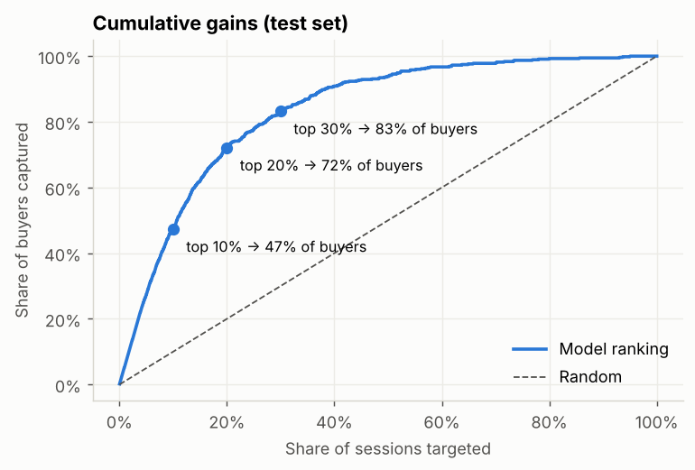
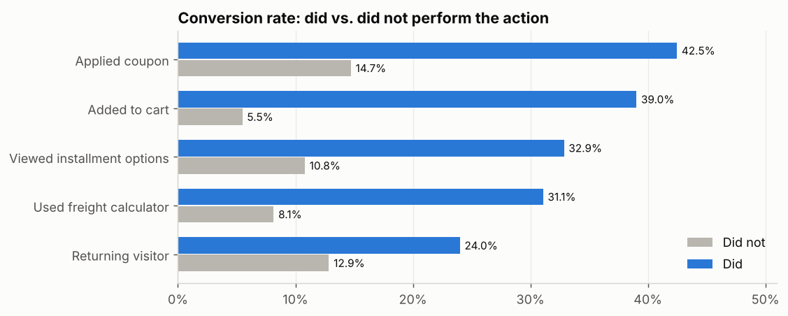

# 🛒 Purchase Intent Prediction for a Brazilian E-commerce

Predicting, **while the visitor is still on the site**, whether a session will end in a purchase — so marketing can spend coupons and follow-ups only where they change the outcome.

> **Portfolio note:** the client *Casa & Estilo* is **fictional** and all data is **synthetic**, generated by [`src/generate_raw_data.py`](src/generate_raw_data.py). The scenario, data problems and business questions are modelled on a typical Brazilian mid-sized online retailer engagement.

  

---

## 1. Client & problem

**Casa & Estilo** sells fashion and home goods online from São Paulo and ships nationwide. Traffic grew strongly in 2025–26, mostly from Instagram and TikTok, but only **~17% of sessions convert**. The marketing team asked three questions:

1. Which channels, devices, regions and dates bring visitors who actually buy?
2. Which on-site behaviours signal buying intent — including Brazil-specific steps such as checking **frete** (shipping cost) and **parcelamento** (installments)?
3. Can we score each live session, so discounts and WhatsApp/e-mail reminders go to hesitant visitors instead of people who would buy anyway?

## 2. Results at a glance

| | |
|---|---|
| Sessions analysed | **15,873** (Oct 2025 – Sep 2026, after cleaning 16,202 raw rows) |
| Final model | Tuned **Histogram Gradient Boosting** in a scikit-learn pipeline |
| Test F1 / Precision / Recall | **0.67 / 0.63 / 0.71** |
| Test PR-AUC / ROC-AUC | **0.75** (no-skill 0.17) / **0.91** |
| Business impact | Targeting the **top 20%** of sessions reaches **72% of buyers** (3.6× random) |

<p align="center"></p>

**Key insights**

- **Channels:** E-mail (28%), WhatsApp (24%) and Direct (23%) convert best; TikTok (9%) and Facebook (11%) bring mostly browsers.
- **Mobile gap:** 67% of sessions are mobile, but mobile converts at 15.8% vs 20.9% on desktop → checkout UX on mobile is the biggest lever.
- **Frete & parcelamento:** visitors who use the freight calculator convert **3.8×** more; those who view installment options **3×** more.
- **Calendar:** Black Friday (23.6%) and Natal (22.4%) lift conversion ~40% above a regular day; Carnaval week is the slowest.
- **Regions:** Sul and Sudeste convert better than Norte/Nordeste/Centro-Oeste, consistent with freight cost and delivery time.

<p align="center"></p>

## 3. Project workflow — from raw export to app

```
raw CSV (messy) ──► 01 cleaning ──► 02 EDA ──► 03 modelling ──► 04 inference ──► Streamlit app
```

| Step | Notebook | What happens |
|---|---|---|
| Data | `src/generate_raw_data.py` | Builds the synthetic raw export with realistic patterns **and** realistic dirt |
| Cleaning | [`01_data_cleaning.ipynb`](notebooks/01_data_cleaning.ipynb) | 211 duplicates, 118 bot sessions, 2 date formats (ISO & `dd/mm/yyyy`), PT/EN labels (`Celular`, `Computador`), `sim/não` booleans, `R$ 1.234,56` text values, negative durations, missing values; adds Brazilian retail-calendar and region features |
| EDA | [`02_eda.ipynb`](notebooks/02_eda.ipynb) | Conversion by channel, device, region, event and month; micro-conversion analysis; numeric drivers |
| Modelling | [`03_modeling.ipynb`](notebooks/03_modeling.ipynb) | 4 models compared with 5-fold stratified CV → tuning (RandomizedSearchCV, PR-AUC) → F1-optimal threshold from out-of-fold predictions → hold-out test, permutation importance, cumulative gains |
| Inference | [`04_model_inference.ipynb`](notebooks/04_model_inference.ipynb) | Score a single session and a batch file; map probability to an action |
| App | [`app.py`](app.py) | Overview, interactive EDA, single-session prediction form, CSV batch scoring |

### Model comparison (5-fold CV on training data)

| Model | F1 | Precision | Recall | PR-AUC |
|---|---|---|---|---|
| Random Forest | 0.640 | 0.532 | 0.803 | 0.712 |
| Hist Gradient Boosting | 0.631 | 0.524 | 0.794 | 0.729 |
| Logistic Regression | 0.627 | 0.508 | 0.818 | 0.730 |
| Decision Tree | 0.587 | 0.466 | 0.803 | 0.671 |

Gradient Boosting was tuned (best CV PR-AUC 0.742) and the decision threshold moved from 0.50 to **0.684**, raising F1 from 0.63 to **0.67** on unseen data.

### From probability to action

| Segment | Rule | Recommended action |
|---|---|---|
| High intent | p ≥ 0.684 | Don't give away a discount — show free-shipping threshold / *"10x sem juros"* banner |
| Medium intent | 0.342 ≤ p < 0.684 | Best target for a coupon or a WhatsApp/e-mail cart reminder |
| Low intent | p < 0.342 | Content, reviews and social proof; no discount |

## 4. Data dictionary (clean data)

| Column | Description |
|---|---|
| `session_id` | Session identifier |
| `session_start` | Session start timestamp |
| `customer_state` / `region` | Brazilian state (UF) and macro-region |
| `device_type` | Mobile / Desktop / Tablet |
| `traffic_source` | Google Orgânico, Google Ads, Instagram, Facebook, TikTok, WhatsApp, E-mail, Direto, Afiliados |
| `visitor_type` | New / Returning |
| `pages_viewed`, `category_pages`, `product_pages`, `searches` | Navigation counts |
| `session_duration_sec`, `product_page_duration_sec` | Time on site / on product pages |
| `add_to_cart_count`, `cart_value_brl`, `wishlist_adds` | Cart activity (R$) |
| `viewed_freight_calculator` | Used the shipping-cost (frete) calculator |
| `viewed_installment_options` | Opened installment (parcelamento) options |
| `coupon_applied` | Applied a discount coupon |
| `bounce_rate`, `exit_rate` | Average page-level bounce / exit rate in the session |
| `page_value_brl` | Average value of pages viewed (GA-style "page value", R$) |
| `sales_event`, `month`, `hour`, `is_weekend` | Calendar features (Black Friday, Natal, Carnaval, Dia das Mães, …) |
| `purchased` | **Target** — 1 if the session ended in an order |

## 5. Repository structure

```
├── app.py                         # Streamlit app
├── data/
│   ├── raw/casa_estilo_sessions_raw.csv     # messy export (synthetic)
│   ├── processed/sessions_clean.csv         # output of notebook 01
│   └── sample/new_sessions.csv              # example file for batch scoring
├── images/                        # charts used in README and app
├── models/
│   ├── purchase_intent_model.joblib         # full pipeline (pre-processing + model)
│   └── model_metadata.json                  # threshold, metrics, features, params
├── notebooks/
│   ├── 01_data_cleaning.ipynb
│   ├── 02_eda.ipynb
│   ├── 03_modeling.ipynb
│   └── 04_model_inference.ipynb
├── src/
│   ├── generate_raw_data.py       # synthetic data generator
│   └── predict.py                 # shared inference helpers
└── requirements.txt
```

## 6. How to run

```bash
git clone https://github.com/brmsyh/brazil-ecommerce-purchase-intent.git
cd brazil-ecommerce-purchase-intent
pip install -r requirements.txt

python src/generate_raw_data.py      # optional: regenerate the raw data
# run notebooks 01 → 04 in order (from the notebooks/ folder)
streamlit run app.py
```

> The saved model was trained with scikit-learn 1.9.1; keep that version (pinned in `requirements.txt`) when loading `purchase_intent_model.joblib`, or re-run notebook 03 to retrain.

## 7. Limitations & next steps

- Data is synthetic: patterns are realistic but simplified. On real data, expect noisier signals and validate with a **time-based split** (train on older months, test on recent ones).
- `page_value_brl` is the strongest feature; in production check that it is available **before** checkout for live scoring.
- Next: A/B test the medium-intent coupon strategy, add probability calibration, and monitor drift around Black Friday.

## 8. Tech stack

Python · pandas · NumPy · scikit-learn (Pipeline, ColumnTransformer, HistGradientBoosting, RandomizedSearchCV) · Matplotlib · Streamlit · joblib

---

**Author:** Yunido Baheramsyah · Data Analyst / Data Scientist · [GitHub @brmsyh](https://github.com/brmsyh)
